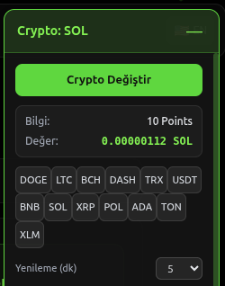
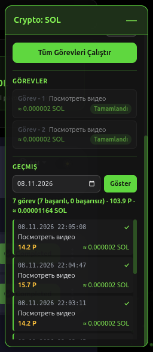
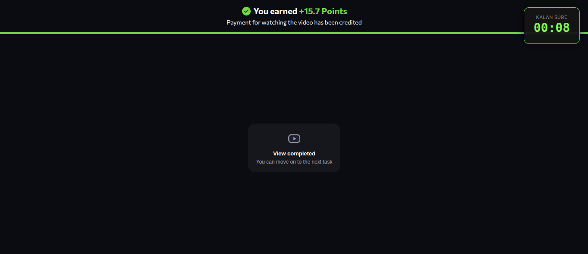
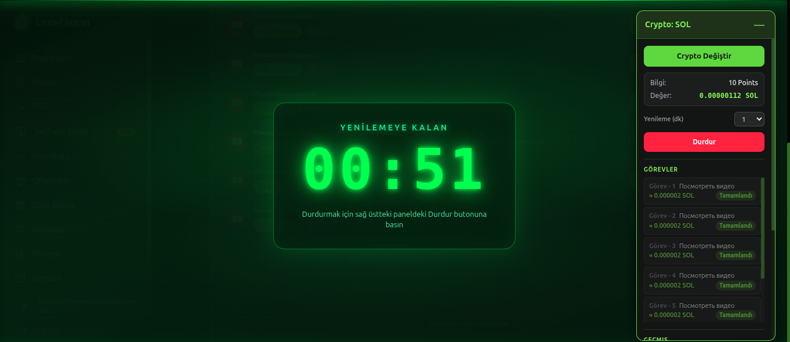

# LimeFaucet Automation (ZoneLimeFaucet)

> **⚠️ ÖNEMLİ DİPNOT:** Bu eklenti **limefaucet.com** sitesine giriş yapılmadan **çalışmaz**. Kullanıcı önce kendi hesabıyla siteye giriş yapmalıdır. Eklenti, tarayıcıda bulunan cookies (çerez) bilgilerini kullanarak çalışır. Giriş yapılmamışsa görevler başlatılamaz.

---

Chrome (Manifest V3) eklentisi.  
**LimeFaucet** sitesindeki YouTube görevlerini otomatik olarak çalıştırır: görevleri başlatır, video sekmesini açar, oynatmayı doğrular, kısa süre izler, görevi tamamlar ve sonuçları kaydeder.

**GitHub:** [https://github.com/barron4335/ZoneLimeFaucet](https://github.com/barron4335/ZoneLimeFaucet)

> **Uyarı:** Bu eklenti eğitim / kişisel otomasyon amaçlıdır. Sitenin kullanım şartlarını ihlal edebilecek şekilde kullanmak hesabınızın kısıtlanmasına yol açabilir. Kendi sorumluluğunuzda kullanın.

---

## Sürümler

| Sürüm | Klasör / Paket              | Açıklama |
|-------|-----------------------------|----------|
| **DesktopZoneLimeFaucet** | `v8.0` | Masaüstü (Chrome / Edge / Chromium) için stabil sürüm |
| **MobileZoneLimeFaucet**  | `v1.6` | Mobil (Lemur Browser + Android) için optimize edilmiş sürüm |

Bu depodaki güncel paket **MobileZoneLimeFaucet v1.6** (manifest `1.6.1`) temellidir. Masaüstü kullanımı için aynı kod tabanı DesktopZoneLimeFaucet **v8.0** olarak işaretlenmiştir.

---

## 📱 MobileZoneLimeFaucet (Mobil Sürüm – v1.6)

**MobileZoneLimeFaucet** klasörü / paketi, eklentinin **mobil telefonlarda** çalışacak şekilde hazırlanmış sürümüdür.

### Kullanmadan Önce Zorunlu Adım
- **Lemur Browser** uygulamasını indirip kurmanız gerekir.  
  (Android cihazlarda Chrome eklentilerini destekleyen tarayıcı)

### Service Worker Uyuma / Ölme Sorunu Düzeltmesi (v1.6)

Manifest V3 Service Worker’lar, tarayıcı tarafından yaklaşık **30 saniye** işlem görmezse otomatik olarak uyutulur / sonlandırılır. Bu durum özellikle mobil ortamda (Lemur Browser) şu sorunlara yol açıyordu:

- Video sekmesi yakalandıktan sonra state kaybolması
- “Open video” sonrası sekmenin kapatılamaması
- Görev tamamlandıktan sonra bir sonraki göreve geçişin bozulması
- Enjeksiyonların (video-content / video-bridge) tekrar çalışmaması

**v1.6’da yapılan düzeltmeler:**

1. **State kalıcılığı** – `chrome.storage.session` yerine **`chrome.storage.local`** kullanıldı. Service Worker öldüğünde bile `awaitingVideoTab` ve `currentVideoTab` bilgileri korunur.
2. **3 katmanlı dayanıklı sekme kapatma**:
   - Öncelik: `sender.tab` üzerinden gelen tab ID
   - İkinci katman: `chrome.storage.local`’den okunan state
   - Üçüncü katman: Tüm açık video sekmelerini tarayan güçlü fallback
3. **Lemur / mobil uyumluluk** – Mobil YouTube (`m.youtube.com`) ve frame yüklemeleri için ek enjeksiyon ve state senkronizasyonu eklendi.
4. **Play doğrulama sonrası koruma** – `playDone` bayrağı set edildikten sonra gereksiz yeniden enjeksiyon engellenir; player reset riski azaltılır.

Bu iyileştirmeler sayesinde 30 saniyelik SW uyuma sorunu büyük ölçüde giderilmiş ve mobil cihazlarda görev akışı stabil hale getirilmiştir.

### Test Edildiği Platformlar

| Platform          | Durum                          |
|-------------------|--------------------------------|
| Android Telefon   | ✅ Test edildi                 |
| Linux             | ✅ Test edildi                 |
| Windows           | ✅ Test edildi                 |

**Test İlerlemesi:**  
`[██████████████████████████████] 100%`  
Tüm platformlarda başarıyla test edilmiştir.

---

## 💻 DesktopZoneLimeFaucet (Masaüstü Sürüm – v8.0)

Masaüstü Chrome / Edge / diğer Chromium tabanlı tarayıcılar için hazırlanan stabil sürümdür.  
Aynı kod tabanını kullanır; Service Worker state yönetimi, video enjeksiyonu ve panel özellikleri Mobile v1.6 ile uyumludur.  
Masaüstü ortamında SW daha uzun süre canlı kaldığı için ek mobil özel optimizasyonlara ihtiyaç duyulmaz, ancak state kalıcılığı sayesinde yine de dayanıklıdır.

---

## FaucetPay Hesabı

LimeFaucet üzerinden kazandığınız kripto paraları çekebilmek için **FaucetPay** hesabına ihtiyacınız vardır.

1. [https://faucetpay.io](https://faucetpay.io) adresinden ücretsiz hesap açın.
2. Hesabınızı doğrulayın ve istediğiniz kripto cüzdan adreslerini ekleyin.
3. LimeFaucet sitesinde ödeme yöntemini FaucetPay olarak seçin ve FaucetPay kullanıcı adınızı / e-posta adresinizi girin.
4. Kazandığınız puanlar belirli bir eşiğe ulaştığında FaucetPay hesabınıza aktarılır. Oradan da kendi cüzdanınıza çekebilirsiniz.

> FaucetPay, birçok faucet sitesinin kullandığı güvenilir bir mikro-ödeme platformudur. Hesap açmak ücretsizdir.

---

## Özellikler

- **Otomatik görev akışı** (8 aşamalı)
  1. Sayfayı ve Shadow DOM görev listesini kaydırma
  2. Bekleyen görevleri okuma
  3. “Start” butonuna tıklama
  4. “Open video” butonunu bekleme ve tıklama
  5. Yeni video sekmesini yakalama
  6. Video oynatmayı gerçekten başlatma + doğrulama
  7. 10–15 saniye arası rastgele izleme süresi
  8. Görevi tamamlayıp kaydetme ve sonraki göreve geçme

- **Yüzen panel** (LimeFaucet /youtube sayfasında)
  - Seçili kripto birimini gösterme / değiştirme
  - Puan → kripto kur bilgisini canlı okuma
  - Görev listesi ve durumları
  - Geçmiş (tarihe göre filtreli)
  - Sürekli döngü + sayfa yenileme aralığı (1–30 dk)

- **Video sekmesi yönetimi**
  - YouTube, blogspot, blogger, embed sayfalarını algılama
  - Dual injection: Isolated world bridge + MAIN world content script
  - Play butonuna tıklama + gerçek oynatma teyidi (`currentTime > 0.2` veya YT Player state === 1)
  - Oynatma düşerse yeniden deneme

- **Veri saklama (IndexedDB)**
  - Çerezler (`cookiesStore`)
  - Görev geçmişi (`tasksStore`) — tarih, puan, kripto ödülü, başarı durumu

- **Popup arayüzü**
  - Durum özeti
  - Çerez yakalama
  - YouTube sayfasına yönlendirme
  - Görevleri başlat / durdur
  - Veritabanını temizleme

---

## Ekran Görüntüleri

### 1. Yüzen Panel – Kripto Değiştirme
Panel üzerinden kripto birimini değiştirebilir, güncel kur bilgisini görebilirsiniz.



### 2. Görev Listesi ve Geçmiş
Tamamlanan görevler, kazanılan puanlar ve geçmiş kayıtları panelde anlık olarak görünür.



### 3. Video Oynatma ve Puan Kazanma
Video izlendikten sonra site “You earned +X Points” bildirimi gösterir. Sağ üstte kalan süre sayacı yer alır.



### 4. Sürekli Döngü – Yenileme Geri Sayımı
Tüm görevler bittikten sonra seçilen aralıkta sayfa yenilenir. Ortada büyük geri sayım, sağda panel görünür.



---

## Kurulum

### Masaüstü (DesktopZoneLimeFaucet v8.0)

1. Chrome’da `chrome://extensions` adresine gidin.
2. Sağ üstten **Geliştirici modu**nu açın.
3. **Paketlenmemiş öğe yükle** butonuna tıklayın.
4. Bu klasörü seçin (`manifest.json`’un bulunduğu dizin).
5. Eklenti yüklendikten sonra LimeFaucet sitesine gidin.

> Not: `host_permissions: ["*://*/*"]` geniş izin istediği için Chrome uyarı verebilir. Sadece kendi kullanımınız için yükleyin.

### Mobil (MobileZoneLimeFaucet v1.6)

1. **Lemur Browser** uygulamasını Android cihazınıza indirin ve kurun.
2. Lemur Browser içinde eklenti yükleme menüsünden **MobileZoneLimeFaucet** klasörünü seçin.
3. LimeFaucet sitesine gidin ve hesabınızla giriş yapın.

---

## Kullanım

### Temel akış
1. `https://limefaucet.com` adresine gidin ve **kendi hesabınızla giriş yapın** (çerezler otomatik yakalanır).
2. Eklenti sizi otomatik olarak `/youtube` sayfasına yönlendirebilir.
3. Sağ üstte yüzen panel görünür.
4. **“Tüm Görevleri Çalıştır”** butonuna basın.
5. Eklenti sırayla görevleri işler:
   - Start → Open video → Yeni sekme → Play doğrulama → 10-15 sn bekle → Sekmeyi kapat → Kaydet

### Sürekli döngü
- “Tüm Görevleri Çalıştır”a bastığınızda sürekli mod açılır.
- Tüm görevler bittikten sonra seçtiğiniz aralıkta (varsayılan 5 dk) sayfa yenilenir ve yeni görevler aranır.
- Durdurmak için paneldeki **Durdur** butonunu veya popup’taki **Görevleri Durdur** butonunu kullanın.

### Kripto değiştirme
Paneldeki **Crypto Değiştir** butonu ile desteklenen birimler arasında geçiş yapabilirsiniz:  
`DOGE, LTC, BCH, DASH, TRX, USDT, BNB, SOL, XRP, POL, ADA, TON, XLM`

### Geçmiş
Panelin alt kısmından tarih seçip o güne ait görev kayıtlarını (başarılı/başarısız, puan, ödül) görebilirsiniz.

---

## Dosya Yapısı

```
├── manifest.json          # Manifest V3 tanımı
├── background.js          # Service worker – sekme yakalama, injection, mesaj yönlendirme
│                          # (v1.6: chrome.storage.local state + 3 katmanlı kapatma)
├── content.js             # Ana content script (limefaucet.com) – panel + görev motoru
├── video-content.js       # MAIN world – video oynatma + countdown
├── video-bridge.js        # Isolated world – postMessage ↔ chrome.runtime köprüsü
├── popup.html / popup.js / popup.css
├── panel.css              # Yüzen panel stilleri
├── img/                   # Ekran görüntüleri
│   ├── resim1.png
│   ├── resim2.png
│   ├── resim3.png
│   └── resim4.png
├── lib/
│   ├── db.js              # IndexedDB yardımcıları
│   └── dom-utils.js       # XPath / görünürlük yardımcıları
```

---

## Teknik Mimari

### Mesajlaşma akışı

```
content.js (limefaucet)
    │  TASK_START_VIDEO
    ▼
background.js
    │  yeni sekme yakalar → injectVideoScripts()
    ▼
video-bridge.js (ISOLATED)  ←→  video-content.js (MAIN)
    │  postMessage (LF_VIDEO)
    ▼
background.js
    │  PLAY_CLICKED / VIDEO_FINISHED / VIDEO_FAILED
    ▼
content.js  →  görevi tamamlar / kaydeder
```

### Video oynatma doğrulama
- YouTube iframe içinde: `video` elementinin `paused === false`, `readyState >= 2` ve `currentTime > 0.2` olması beklenir.
- Üst frame (blogspot vb.): YouTube IFrame API (`YT.get().getPlayerState() === 1`) kullanılır.
- Play teyit edilmeden `PLAY_CLICKED` gönderilmez (yanlış pozitif azaltılır).

### Injection stratejisi
- `chrome.scripting.executeScript` ile hem Isolated hem MAIN world’e enjekte edilir.
- `PLAY_CLICKED` geldikten sonra `playDone = true` ile yeni enjeksiyon yapılmaz (player reset önlenir).
- Frame yüklemelerinde `webNavigation.onCompleted` ile ek enjeksiyon yapılır.

### Service Worker dayanıklılığı (v1.6+)
- Kritik state (`awaitingVideoTab`, `currentVideoTab`) `chrome.storage.local` içinde tutulur.
- SW öldüğünde bile state geri yüklenir ve sekme kapatma / görev devamı çalışmaya devam eder.
- Özellikle Lemur Browser ve mobil ortamlarda 30 saniyelik idle timeout’a karşı koruma sağlar.

### Kur hesaplama
Sayfadaki “X Points ≈ Y COIN” bilgisinden dinamik oran okunur.  
Ödül = `puan × (crypto / points)` şeklinde 8 ondalığa yuvarlanarak hesaplanır.

---

## Önemli Sabitler

| Sabit                      | Değer      | Açıklama                          |
|----------------------------|------------|-----------------------------------|
| `TASK_LIST_REFRESH_MS`     | 3000       | Panel görev listesi yenileme      |
| İzleme süresi              | 10–15 sn   | Rastgele                          |
| Yenileme aralığı           | 1–30 dk    | Kullanıcı seçimli (varsayılan 5)  |
| `awaitingVideoTab` timeout | 18–20 sn   | Video sekmesi bekleme süresi      |
| SW idle timeout (MV3)      | ~30 sn     | v1.6 state kalıcılığı ile aşılır  |

---

## Bilinen Sınırlamalar / Notlar

- Site arayüzü (özellikle Shadow DOM) değişirse seçiciler kırılabilir.
- Bazı video sayfalarında autoplay / muted politikaları yüzünden oynatma teyidi gecikebilir.
- `host_permissions: *://*/*` çok geniştir; sadece gerekli domainlere indirgenebilir.
- Manifest’te ikon tanımlanmamıştır.
- Mobilde (Lemur) Service Worker davranışları tarayıcı sürümüne göre değişiklik gösterebilir; v1.6 state kalıcılığı bu riski minimize eder.

---

## Geliştirme İpuçları

- Console logları `[LF]`, `[BG]`, `[LF-BRIDGE]` önekleriyle filtrelenebilir.
- Video sekmesinde `window.__lfVideoDone` ve `window.__lfVideoRunning` bayrakları tekrar enjeksiyonu engeller.
- Panel sürükle-bırak destekler.
- Sürekli mod `chrome.storage.local` içinde `lfContinuousMode`, `lfRefreshMinutes` olarak saklanır.
- State’i temizlemek için popup’taki “Veritabanını Temizle” veya `chrome.storage.local` üzerinden `lfAwaitingVideoTab` / `lfCurrentVideoTab` anahtarlarını silebilirsiniz.

---

## Lisans / Sorumluluk

Bu proje kişisel kullanım için hazırlanmıştır.  
LimeFaucet veya ilgili sitelerin hizmet şartlarını ihlal etmekten doğacak sonuçlardan kullanıcı sorumludur.

---

## Repo

Kaynak kod ve güncellemeler:  
**https://github.com/barron4335/ZoneLimeFaucet**

---

**MobileZoneLimeFaucet v1.6** · **DesktopZoneLimeFaucet v8.0**
